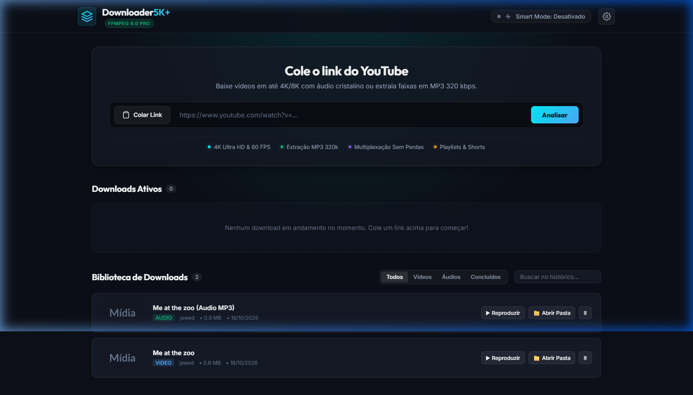
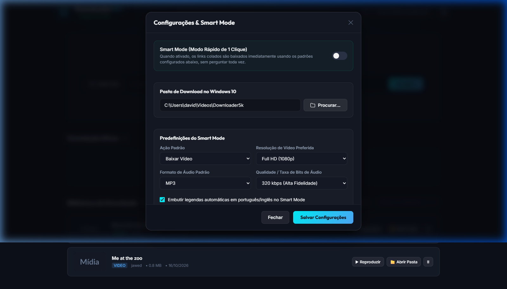

# 🚀 Downloader 5K+

<p align="center">
  
</p>

<p align="center">
  <strong>O poder dos maiores baixadores de vídeo comerciais, com a liberdade e transparência do código aberto.</strong><br>
  Construído com base na análise arquitetural e engenharia reversa do <em>4K Video Downloader+</em>.
</p>

<p align="center">
  
  
  
  
  
  
</p>

---

## 📖 Sobre o Projeto

O **Downloader 5K+** é um sistema completo, autônomo e de alta performance desenvolvido especialmente para **Windows 10 e Windows 11**. Ele reúne todas as funcionalidades premium de ferramentas comerciais de prateleira (como *4K Video Downloader+*), eliminando limites diários de download, chaves de ativação, assinaturas pagas e riscos de obsolescência de parsers.

Projetado para operar por meio de uma **interface Web moderna com tema escuro profissional (Dark Glassmorphism)**, ele combina um núcleo assíncrono em Python com o motor de multiplexação **FFmpeg** e a biblioteca aberta **yt-dlp**, que recebe atualizações diárias para acompanhar qualquer mudança nos algoritmos do YouTube.

---

## ✨ Recursos em Destaque

| Recurso | Descrição |
| :--- | :--- |
| ⚡ **Smart Mode (1 Clique)** | Ative no cabeçalho para baixar vídeos instantaneamente ao colar o link, sem formulários ou perguntas adicionais. |
| 📺 **Vídeos em Qualidade Máxima** | Suporte a **8K, 4K (2160p), 2K (1440p), Full HD (1080p a 60 FPS)** e 720p nos formatos **MP4**, **MKV** e **WebM**. |
| 🎧 **Extração de Áudio de Estúdio** | Extração de áudio cristalino em **MP3 (até 320 kbps)**, M4A/AAC, FLAC Lossless, WAV e OPUS com **incorporação automática da thumbnail como capa do álbum** e metadados ID3. |
| 📑 **Detecção Inteligente de Playlists** | Identifica links de playlists e vídeos individuais em playlists, abrindo um modal interativo para **selecionar vídeos específicos ou baixar todos em lote**. |
| 🚦 **Fila Semafórica Anti-Travamento** | Gerencia até 3 downloads simultâneos em paralelo com fila automática, evitando bloqueios de IP (HTTP 429), consumo excessivo de banda e travamentos de disco. |
| 🗄️ **Banco de Dados SQLite (WAL Mode)** | Histórico permanente com filtros (Todos, Vídeos, Áudios, Concluídos) e busca rápida. O modo WAL garante que o banco nunca trave sob alta concorrência. |
| 📁 **Integração Total com Windows 10** | Botão **"📁 Abrir Pasta"** (revela e seleciona o arquivo diretamente no Windows Explorer) e botão **"▶ Reproduzir"** (abre no reprodutor padrão do sistema). |
| 🗂️ **Seletor de Diretório Nativo** | Escolha graficamente onde deseja salvar seus arquivos usando a janela nativa do Windows através do botão "Procurar...". |
| 🌐 **Bypass de Restrições (Cookies)** | Suporte opcional à importação de sessão do seu navegador (Edge, Chrome, Brave, Firefox) para baixar conteúdos privados ou com restrição de idade sem CAPTCHAs. |

---

## 📸 Telas da Aplicação

### Interface Principal e Biblioteca
<p align="center">
  
</p>

### Configurações do Sistema e Smart Mode
<p align="center">
  
</p>

---

## ⚖️ Comparativo: Downloader 5K+ vs Soluções Comerciais

| Funcionalidade | 4K Video Downloader+ (Original) | Downloader 5K+ |
| :--- | :---: | :---: |
| **Limite Diário de Downloads** | ❌ Limitado na versão grátis | ✅ **Ilimitado e Livre** |
| **Qualidade 4K / 8K a 60 FPS** | ❌ Exige licença paga | ✅ **100% Gratuito** |
| **Extração de Áudio MP3 320k** | ❌ Exige licença paga | ✅ **Incluso com capa ID3** |
| **Download de Playlists em Lote** | ❌ Limitado a 10 vídeos na versão grátis | ✅ **Playlists Ilimitadas** |
| **Abertura Direta no Windows Explorer** | ✅ Sim | ✅ **Sim (`/select,`)** |
| **Interface Moderna no Navegador** | ❌ Apenas binário C++ Qt | ✅ **Web Moderna & Responsiva** |
| **Atualizações de Cifra do YouTube** | ❌ Depende da empresa lançar update | ✅ **Suporte ativo contínuo (yt-dlp)** |

---

## 🛠️ Como Instalar e Rodar no Windows 10/11

### Pré-requisitos
1. **Python 3.10 ou superior:** [Baixar no site oficial do Python](https://www.python.org/downloads/) (marque a caixa *"Add Python to PATH"* durante a instalação).
2. **FFmpeg:** Necessário para união de áudio e vídeo em alta resolução. Caso ainda não tenha, basta instalar pelo terminal com o comando do Windows:
   ```powershell
   winget install Gyan.FFmpeg
   ```

---

### Método 1: Inicialização Rápida (1 Duplo-Clique)

1. Baixe ou clone o repositório em sua máquina:
   ```bash
   git clone https://github.com/davidmp24/Downloader5K-.git
   cd Downloader5K-
   ```
2. Dê um **duplo clique no arquivo `iniciar.bat`**.
3. O script irá automaticamente:
   - Criar o ambiente virtual `.venv` (se ainda não existir).
   - Instalar todas as dependências necessárias do `requirements.txt`.
   - Iniciar o servidor local.
   - Abrir o seu navegador padrão automaticamente em **`http://127.0.0.1:8000`**.

---

### Método 2: Execução Manual pelo Terminal (PowerShell / CMD)

```powershell
# 1. Crie e ative o ambiente virtual
python -m venv .venv
.\.venv\Scripts\activate

# 2. Instale as dependências
pip install -r requirements.txt

# 3. Inicie o sistema
python main.py
```

O aplicativo estará disponível em:
👉 **[http://127.0.0.1:8000](http://127.0.0.1:8000)**

---

## 💡 Guia de Uso Passo a Passo

### 1. Baixar Vídeo ou Áudio Avulso
1. Copie o link de qualquer vídeo ou Shorts do YouTube.
2. Na página do **Downloader 5K+**, clique no botão **"Colar Link"**.
3. O sistema inspecionará as resoluções disponíveis.
4. Escolha se deseja:
   - **Aba Vídeo:** Selecione a resolução (4K, 1080p, 720p) e o container (MP4 ou MKV).
   - **Aba Áudio:** Selecione o formato (MP3 320k, FLAC, M4A, WAV).
5. Clique em **"Iniciar Download"**.

### 2. Baixar Playlists (Selecionar Vídeos ou Todos)
1. Copie o link de qualquer playlist do YouTube (ex: `https://www.youtube.com/playlist?list=...` ou um vídeo dentro de uma playlist).
2. Clique em **"Colar Link"**.
3. O sistema identificará automaticamente que se trata de uma playlist e abrirá o **Modal de Playlist**.
4. Você verá a contagem total, capa, miniaturas de todos os vídeos e suas durações:
   - Use **"✓ Selecionar Todos"** para baixar a playlist completa.
   - Ou clique nos itens/checkboxes para marcar apenas os vídeos que deseja.
5. Escolha o formato de saída (Vídeo com resolução ou Áudio MP3).
6. Clique em **"Baixar Selecionados (X)"**. Os itens entrarão na fila de downloads e serão processados organizadamente.

### 3. Usar o Smart Mode (Modo Ultra Rápido)
1. Clique no botão de engrenagem ⚙️ e configure suas preferências:
   - Ação padrão (Vídeo 1080p ou Áudio MP3 320k).
   - Pasta de salvamento no seu Windows.
2. Ative a chave do **Smart Mode** no cabeçalho.
3. A partir de agora, ao colar qualquer link de vídeo avulso, o download começará imediatamente sem abrir janelas extras!

### 4. Abrir e Reproduzir seus Arquivos
- Na seção **Biblioteca de Downloads**, todos os arquivos baixados ficam salvos com título, data e tamanho.
- Clique em **"📁 Abrir Pasta"** para abrir o Windows Explorer selecionando o arquivo baixado.
- Clique em **"▶ Reproduzir"** para abrir o arquivo no player padrão do Windows (VLC, Windows Media Player, etc.).

---

## 📂 Estrutura do Repositório

```
Downloader5K-/
├── backend/
│   ├── api.py           # Endpoints FastAPI, WebSockets e rotas de download
│   ├── db.py            # Esquema SQLite (WAL mode, timeouts e travas de escrita)
│   └── downloader.py    # Motor yt-dlp, FFmpeg, hooks em tempo real e fila semafórica
├── frontend/
│   ├── css/
│   │   └── style.css    # Design System moderno, responsivo com dark mode e animações
│   ├── js/
│   │   └── app.js       # Controle da UI, WebSockets, modais, playlists e clipboard
│   └── index.html       # Estrutura HTML5 da aplicação
├── docs/
│   └── screenshots/     # Imagens da interface para documentação
├── data/
│   └── .gitkeep         # Diretório do banco de dados SQLite local
├── iniciar.bat          # Inicializador com 1 clique para Windows 10/11
├── main.py              # Ponto de entrada e abertura do navegador
├── requirements.txt     # Dependências Python essenciais
├── .gitignore           # Exclusões de arquivos temporários e virtuais
└── README.md            # Documentação oficial do projeto
```

---

## 🔒 Privacidade e Segurança

- **100% Local:** Todo o processamento, banco de dados e arquivos ficam armazenados exclusivamente no seu computador.
- **Sem Telemetria:** Nenhuma informação sobre os vídeos baixados ou links acessados é transmitida para servidores externos.
- **Transparência Total:** Código aberto auditável e sem binários fechados.

---

## 🤝 Contribuições

Contribuições são sempre bem-vindas! Sinta-se à vontade para abrir uma **Issue** relatando dúvidas/sugestões ou enviar um **Pull Request**.

1. Faça um Fork do projeto.
2. Crie uma branch para a sua funcionalidade (`git checkout -b feature/MinhaFeature`).
3. Commit suas alterações (`git commit -m 'Adiciona MinhaFeature'`).
4. Faça o push para a branch (`git push origin feature/MinhaFeature`).
5. Abra um Pull Request.

---

## 📄 Licença

Este projeto é distribuído sob a licença **MIT**. Consulte o arquivo de licença para mais detalhes.

<p align="center">
  Desenvolvido com dedicação por <strong><a href="https://github.com/davidmp24">davidmp24</a></strong>.
</p>
