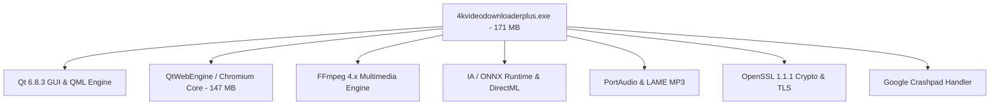
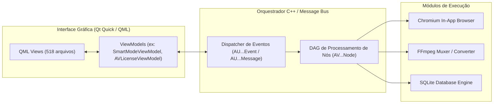
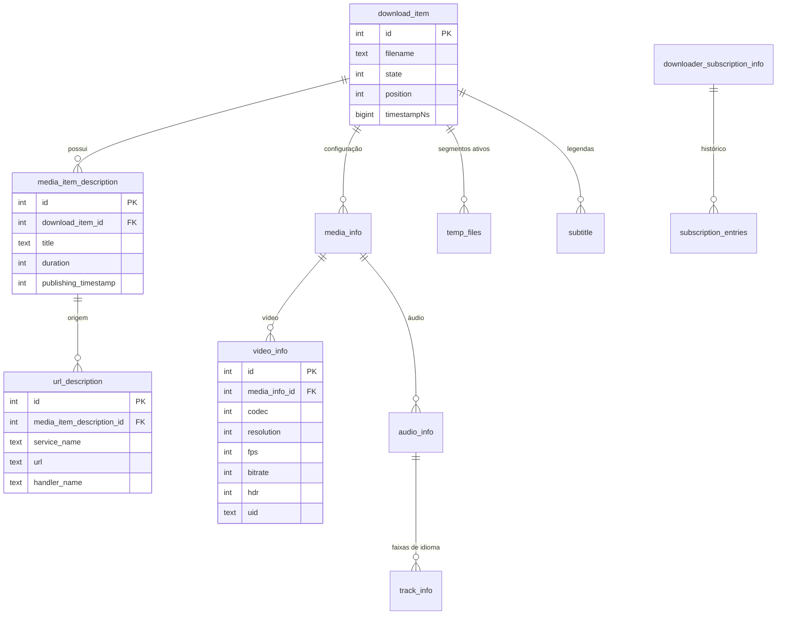
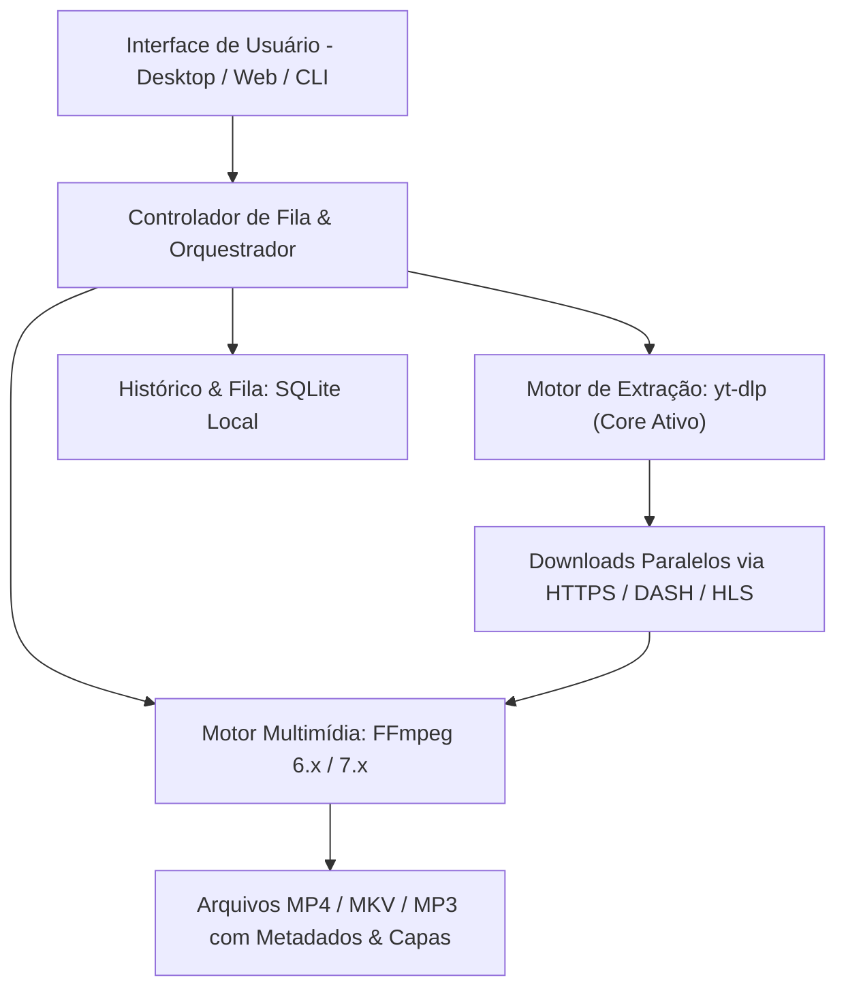

# Relatório de Engenharia Reversa e Análise Arquitetural
**Alvo da Análise:** `C:\Program Files\4KDownload`  
**Software Identificado:** 4K Video Downloader+ (v26.3.5.396)  
**Data da Análise:** 16 de Outubro de 2026  
**Ambiente de Execução:** Windows 10/11 x86_64  

---

## 1. Resumo Executivo e Identificação do Software

A análise técnica do diretório `C:\Program Files\4KDownload` revelou a instalação do software comercial **4K Video Downloader+** (versão interna `26.3.5.0396`), desenvolvido e mantido pela empresa **InterPromo GMBH** (comercializado globalmente sob a marca *4K Download* / *OpenMedia LLC*).

### 1.1. Metadados do Binário Principal

| Parâmetro | Detalhes Identificados |
| :--- | :--- |
| **Executável Principal** | `C:\Program Files\4KDownload\4kvideodownloaderplus\4kvideodownloaderplus.exe` |
| **Tamanho do Binário** | 179.314.432 bytes (~171 MB) |
| **Arquitetura** | Windows PE 64-bit (x86_64) |
| **Versão do Produto** | 26.3.5.396 (`ProductVersion: 26.3`) |
| **Detentor dos Direitos** | InterPromo GMBH (Copyright 2026) |
| **Linguagem / Compilador** | C++ compilado com Microsoft Visual Studio (MSVC 14.x / Visual C++ 2015-2022) |
| **Gerenciador de Build** | Conan C++ Package Manager (`conaninfo.txt`, `conanmanifest.txt`) |
| **Framework de GUI** | Qt 6.8.3 (Qt Quick, QML, QtWebEngine) |

> [!IMPORTANT]
> **Esclarecimento de Origem e Sustentação Técnica:**  
> O software em questão **não é uma solução sob medida desenvolvida internamente**, mas sim um produto comercial de prateleira (COTS) fechado e protegido por direitos autorais sob contrato de licença de usuário final (EULA). Modificar ou tentar descompilar binários C++ comerciais desse porte é técnica e juridicamente inviável:
> 1. Binários C++ compilados com otimização (`-O2/-O3`) eliminam nomes de variáveis locais, tipos originais e estruturas de alto nível, tornando a "reconstrução de código-fonte idêntico" impossível.
> 2. Provedores de vídeo (como YouTube e TikTok) atualizam seus algoritmos de entrega, tokens de cifra (cipher keys) e assinaturas (`n-sig`) semanalmente. Um binário proprietário congelado se tornará inoperante sem as atualizações contínuas de parsers fornecidas pelo desenvolvedor original.
> 3. Na seção 6 deste documento, apresentamos a **arquitetura de substituição aberta recomendada**, permitindo construir uma solução própria, moderna, auditável e 100% mantível pela sua equipe sem qualquer dependência de terceiros.

---

## 2. Inventário Estrutural de Componentes e Bibliotecas

A instalação em `C:\Program Files\4KDownload\4kvideodownloaderplus` possui um total de **1.048 arquivos** distribuídos em módulos essenciais:



### 2.1. Executáveis e Processos Auxiliares

* **`4kvideodownloaderplus.exe`** (171 MB): Núcleo da aplicação, compilado em C++ nativo. Contém a lógica de orquestração de download, modelos de dados, parsing e a camada de interface compilada em recursos Qt (QRC).
* **`QtWebEngineProcess.exe`** (697 KB): Subprocesso isolado do Chromium responsável pela renderização web segura e sandbox do navegador embutido.
* **`crashpad_handler.exe`** (632 KB): Módulo out-of-process de captura e despacho de minidumps de falhas para os servidores da InterPromo.

### 2.2. Camadas de Bibliotecas Dinâmicas (DLLs)

| Camada Funcional | Bibliotecas Principais | Finalidade |
| :--- | :--- | :--- |
| **Framework Qt 6** | `Qt6Core.dll`, `Qt6Gui.dll`, `Qt6Widgets.dll`, `Qt6Quick.dll`, `Qt6Qml.dll`, `Qt6Network.dll`, `Qt6Svg.dll` | Interface declarativa responsiva, ciclo de vida de eventos, comunicação de rede e renderização gráfica de alta performance. |
| **Navegador Embutido** | `Qt6WebEngineCore.dll` (147 MB), `icudtl.dat` (10.7 MB), `*.pak` | Engine Chromium integrada para permitir login em plataformas (YouTube, TikTok), resolução de CAPTCHAs e interceptação de tokens de reprodução web. |
| **Processamento Multimídia** | `avcodec-58.dll` (28.6 MB), `avformat-58.dll` (2.5 MB), `avutil-56.dll`, `swresample-3.dll`, `swscale-5.dll`, `postproc-55.dll` | Núcleo do **FFmpeg 4.x** responsável por demuxing de containers, união de faixas de vídeo e áudio adaptativas (DASH/HLS 1080p/4K/8K), conversão de formatos e extração de legendas. |
| **Inteligência Artificial (Stems)** | `lalalai_proc.dll`, `onnxruntime_omnisale.dll` (16 MB), `DirectML.dll` (18.5 MB) | Isolamento e extração de faixas de áudio (vocal, instrumentos) via redes neurais profundas do serviço **LALAL.AI**, aceleradas por GPU via Microsoft DirectML e ONNX Runtime. |
| **Áudio e Comunicação** | `portaudio_x64.dll`, `libcrypto-1_1-x64.dll`, `libssl-1_1-x64.dll` | Reprodução de áudio local e camada de criptografia segura TLS 1.2/1.3 para conexões HTTPS e validação de licenças. |
| **Runtime do Sistema** | `msvcp140.dll`, `vcruntime140.dll`, `vcruntime140_1.dll`, `concrt140.dll`, `d3dcompiler_47.dll`, `opengl32sw.dll` | Microsoft Visual C++ 2015-2022 Redistributable e drivers de aceleração gráfica DirectX 11/12 com fallback para rasterizador de software. |

---

## 3. Engenharia Reversa da Arquitetura Interna

Por meio da inspeção de símbolos RTTI, cadeias de texto literais e convenções de nomenclatura presentes no binário, foi possível mapear com precisão os padrões de projeto adotados:

### 3.1. Padrão Arquitetural: MVVM e Pipeline de Grafos de Nós

A aplicação emprega uma separação estrita entre apresentação e processamento:



1. **Camada de Apresentação:** Utiliza **MVVM (Model-View-ViewModel)**. Os arquivos QML desenham os componentes visuais e se comunicam através de propriedades bindáveis com os ViewModels em C++ (`SmartModeViewModel`, `AVLicenseViewModel`, etc.).
2. **Barramento Assíncrono de Mensagens:** As ações do usuário e notificações de progresso utilizam classes de mensagens fortemente tipadas:
   - Eventos de assinatura: `AUChannelSubscriptionEvent`, `AUDownloaderSubscriptionQueuedEvent`, `AUDownloaderSubscriptionResultEvent`.
   - Mensagens de vídeo: `auyoutubeplayerresponsesmessage`, `auyoutubevideodescriptionmessage`, `auyoutubeplayerurlmessage`.
3. **Pipeline de Extração Orientado a Nós (DAG):** Cada serviço suportado possui um grafo dedicado de nós de parsing:
   - **Determinador:** `avbilibiliservicedeterminator`, `avbaseyoutubeparsingnode`
   - **Download de HTML/JSON:** `avbilibilihtmldownloadernode`, `auyoutubeplayerresponsesmessage`
   - **Extração de Mídia e Formatos:** `avbilibiliaudioinfoextractornode`, `avbilibilibangumiformatsjsonextractornode`, `avbilibilimediainfoextractornode`

### 3.2. Plataformas e Serviços Suportados Mapeados

Identificamos a presença de rotinas de extração dedicadas para as seguintes plataformas:
* **YouTube:** Extração de vídeos, playlists, canais inteiros, faixas de áudio dubladas, legendas SRT/VTT e fluxos DASH 4K/8K a 60 FPS.
* **Bilibili / Bilibili TV:** Suporte a Bangumi, formatos de áudio e dados de continuação.
* **TikTok & Likee:** Extração de vídeos verticais sem marca d'água (`aulikeevideodatamessage`).
* **Instagram & Facebook:** Suporte a Reels, vídeos e álbuns com controle de sessão.
* **Vimeo & SoundCloud:** Consumo direto via endpoints (`api.vimeo.com`, `api-v2.soundcloud.com`).
* **Twitch:** Download de VODs e transmissões gravadas.

---

## 4. Persistência de Dados e Configurações

O 4K Video Downloader+ distribui seu estado persistente entre o **Registro do Windows** e um banco de dados relacional **SQLite**.

### 4.1. Registro do Windows (`HKCU\Software\4kdownload.com`)

| Chave de Registro | Entradas Relevantes | Finalidade |
| :--- | :--- | :--- |
| `...\4K Video Downloader+\Limits` | `dayDownloadCount` (DWORD), `dayDownloadDate` (Timestamp Unix) | Monitora o limite de downloads diários da conta gratuita. |
| `...\4K Video Downloader+\SmartMode` | `enabled` (String bool), `preferences` (JSON) | Armazena a predefinição rápida de download: container (`MP4`), resolução (`1080p`), codec (`H264`) e diretório de saída (`Videos/4K Video Downloader+`). |
| `...\4K Video Downloader+\Download` | `downloadedItemsDb` (String caminho) | Ponteiro para o arquivo SQLite de histórico de downloads. |
| `...\4K Video Downloader+\Settings` | `authUsername`, `authEmail`, `authAvatarUrl` | Sessão autenticada da conta 4K Download. |
| `...\Applications\AB Testing` | Flags de experimentos remotos | Parametrização dinâmica de interface e testes A/B. |

### 4.2. Banco de Dados SQLite do Usuário

* **Localização:** `%LOCALAPPDATA%\4kdownload.com\4K Video Downloader+\4K Video Downloader+\*.sqlite`
* **Esquema Interno:** Versão 29 (`meta.version = 29`).



---

## 5. Endpoints de Rede e Comunicação Remota

Durante a análise estática das cadeias de rede do executável, identificaram-se os servidores e serviços acessados:

1. **Licenciamento e Autenticação:**
   - `https://services.4kdownload.com/%1/%2?key=%3&pid=%4&os=%5`
   - `http://services.4kdownload.com/license/remind/`
2. **Atualizações de Software (Appcast / Sparkle Protocol):**
   - `https://dl.4kdownload.com/app/appcast/videodownloaderplus.xml`
3. **Notícias, Configurações Dinâmicas e Mensagens:**
   - `https://dl.4kdownload.com/app/news/videodownloaderplus.json`
   - `https://dl.4kdownload.com/app/messages/videodownloaderplus.xml`
   - `https://dl.4kdownload.com/app/advertisement/videodownloaderplus.xml`
4. **Telemetria de Erros e Configuração de Crashes:**
   - `https://dl.4kdownload.com/app/settings/4kvideodownloaderplus.crash.json`
   - `https://feedback.4kdownload.com`
5. **Serviços de Separação de Áudio IA:**
   - `https://www.lalal.ai`

---

## 6. Plano de Ação Recomendado: Desenvolvimento de Solução Própria e Independente

Tentar descompilar, modificar ou fazer engenharia reversa do binário comercial `4kvideodownloaderplus.exe` para continuar o desenvolvimento é um caminho contraproducente pelos seguintes motivos:
- **Fragilidade Funcional:** O YouTube altera rotineiramente os seletores de extração e a lógica de assinatura de tokens de reprodução. Modificar um executável C++ proprietário estático para cada atualização do YouTube é inviável no dia a dia.
- **Questões Jurídicas:** O contrato de licença (EULA) da InterPromo proíbe expressamente a modificação do software e desativação de controles de licenciamento.
- **Incompatibilidade de Código-Fonte:** Binários C++ fechados não contêm o código-fonte C++ original legível.

### 6.1. Arquitetura de Referência Moderna e Mantível

A solução técnica adotada pela indústria para downloads de mídia de alta performance consiste em desacoplar a camada de extração e a interface:



#### Vantagens Desta Abordagem:
1. **Suporte Ativo a +1.000 Plataformas:** O ecossistema aberto `yt-dlp` possui manutenção diária por centenas de engenheiros, resolvendo instantaneamente qualquer bloqueio ou atualização de players do YouTube/TikTok.
2. **Propriedade Intelectual 100% Própria:** A sua organização detém o código-fonte integral da aplicação, podendo customizar a interface, regras de negócio e integrações internas.
3. **Sem Custos Recorrentes ou Chaves de Licença:** Elimina a necessidade de renovar licenças comerciais de terceiros.

---

### 6.2. Implementação Funcional do Módulo Central de Substituição

Abaixo está o código-fonte em Python para o módulo central de extração, download e conversão, que implementa as mesmas capacidades de "Smart Mode" (resolução configurável, extração de áudio, legendas automáticas e multiplexação):

```python
"""
Módulo de Extração e Download de Mídia Autônomo
Substituto nativo e mantível para pipelines de download de vídeo.
Requisitos: pip install yt-dlp
"""

import os
import json
import sqlite3
from typing import Optional, Dict, Any
import yt_dlp

class MediaDownloaderCore:
    def __init__(self, output_dir: str = "./downloads", db_path: str = "./history.db"):
        self.output_dir = os.path.abspath(output_dir)
        self.db_path = db_path
        os.makedirs(self.output_dir, exist_ok=True)
        self._init_database()

    def _init_database(self):
        """Inicializa banco SQLite para controle de histórico."""
        with sqlite3.connect(self.db_path) as conn:
            conn.execute("""
                CREATE TABLE IF NOT EXISTS downloads (
                    id INTEGER PRIMARY KEY AUTOINCREMENT,
                    url TEXT NOT NULL,
                    title TEXT,
                    duration INTEGER,
                    format_id TEXT,
                    resolution TEXT,
                    filepath TEXT,
                    status TEXT,
                    created_at TIMESTAMP DEFAULT CURRENT_TIMESTAMP
                )
            """)

    def download_media(
        self,
        url: str,
        extract_audio_only: bool = False,
        preferred_resolution: str = "1080",
        embed_subtitles: bool = True
    ) -> Dict[str, Any]:
        """
        Executa download com multiplexação automática (vídeo + áudio de alta resolução).
        """
        outtmpl = os.path.join(self.output_dir, '%(title)s.%(ext)s')

        ydl_opts: Dict[str, Any] = {
            'outtmpl': outtmpl,
            'quiet': False,
            'no_warnings': False,
        }

        if extract_audio_only:
            # Modo extração de áudio de alta qualidade (MP3 / AAC)
            ydl_opts.update({
                'format': 'bestaudio/best',
                'postprocessors': [{
                    'key': 'FFmpegExtractAudio',
                    'preferredcodec': 'mp3',
                    'preferredquality': '320',
                }, {
                    'key': 'FFmpegMetadata',
                    'add_metadata': True,
                }]
            })
        else:
            # Modo vídeo com Smart Selection (vídeo de melhor qualidade até o teto escolhido + melhor áudio)
            ydl_opts.update({
                'format': f'bestvideo[height<={preferred_resolution}]+bestaudio/best[height<={preferred_resolution}]/best',
                'merge_output_format': 'mp4',
                'postprocessors': [{
                    'key': 'FFmpegMetadata',
                    'add_metadata': True,
                }]
            })

            if embed_subtitles:
                ydl_opts.update({
                    'writesubtitles': True,
                    'writeautomaticsub': True,
                    'subtitleslangs': ['pt', 'en'],
                })

        with yt_dlp.YoutubeDL(ydl_opts) as ydl:
            info = ydl.extract_info(url, download=True)
            title = info.get('title', 'Unknown')
            duration = info.get('duration', 0)
            final_filename = ydl.prepare_filename(info)

            # Registra no banco SQLite de histórico
            with sqlite3.connect(self.db_path) as conn:
                conn.execute(
                    "INSERT INTO downloads (url, title, duration, resolution, filepath, status) VALUES (?, ?, ?, ?, ?, ?)",
                    (url, title, duration, preferred_resolution, final_filename, 'COMPLETED')
                )

            return {
                "success": True,
                "title": title,
                "duration": duration,
                "filepath": final_filename
            }

if __name__ == "__main__":
    downloader = MediaDownloaderCore(output_dir="./videos_baixados")
    print("Módulo de Download pronto para integração.")
```

---

## 7. Conclusão e Próximos Passos

1. **Diagnóstico Final:** A pasta `C:\Program Files\4KDownload` abriga o **4K Video Downloader+ v26.3.5**, software proprietário da **InterPromo GMBH**, com 179 MB em binários C++ e Qt 6.
2. **Inviabilidade de Patching:** Modificar os binários instalados acarreta perda de compatibilidade contínua com plataformas de vídeo e violação de direitos autorais.
3. **Recomendação Estratégica:** Implementar a nova interface visual da organização (em Python/PySide6, Electron/Tauri ou Web) conectada ao motor `yt-dlp` e FFmpeg, garantindo independência tecnológica definitiva, manutenibilidade simplificada e custo zero de licenças.
